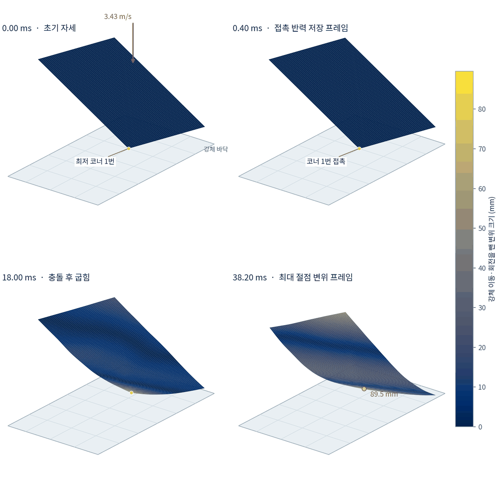
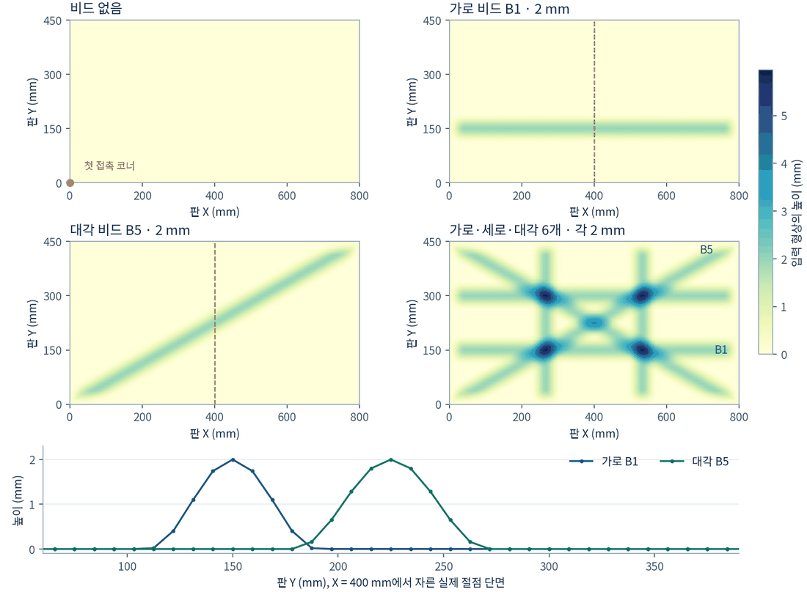
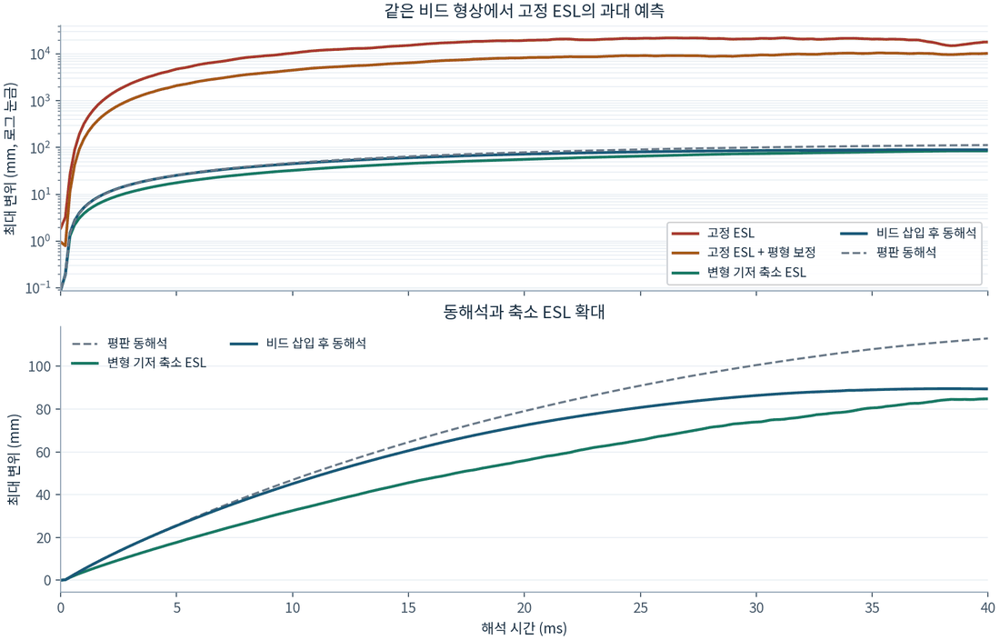
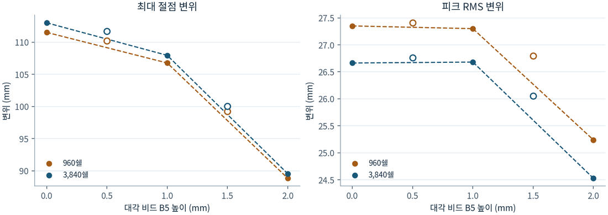

# 평판에서 비드 삽입 후 고정 ESL 과대 변위 확인

60° 코너 낙하, 3,840쉘에서 대각 비드를 2 mm 올렸을 때, 평판의 최대 절점 변위 113.0 mm는 실제 재낙하에서 89.5 mm로 감소했다. 평판의 하중을 고정한 ESL은 같은 비드판에서 22,202 mm를 냈다. 합력·합모멘트를 보정한 경우 10,586 mm, 변형 기저 축소 ESL은 84.8 mm였다. 모두 강체 이동과 회전을 제거한 뒤 0~40 ms의 최댓값이다.

## 낙하 장면과 형상

800 × 450 × 0.8 mm 탄성 강판을 바닥 기준 60°로 세웠다. 초기 간극 0.6 mm에서 하향 속도 3.431 m/s로 시작해 600 mm 낙하에 해당하는 에너지를 부여했다. 중력 9.81 m/s², 강체 바닥 마찰 0.15, 판의 동해석 고정점은 없다. 대각 비드 B5 2 mm의 3,840쉘 계산에서 첫 법선 벽 충격량은 0.161~0.180 ms 사이에 기록됐고, 0.401 ms 저장 프레임에서 접촉 절점은 1번이었다. 변형을 확대하지 않은 네 프레임이다.

B1은 Y = 150 mm의 가로 비드이고 B5는 낙하 코너를 지나는 대각선이다. 6개 비드판은 가로·세로·대각 방향 두 줄씩이다. 비드는 폭 80 mm, 교차부 높이는 같은 위치의 개별 높이를 합산한다. `flat`과 비드판은 같은 메시 연결과 절점 ID를 사용한다. 탄성 LAW1 및 쉘 두께도 동일하다.

## 고정 ESL과 대안을 동일한 비드판에서 비교

평판 동해석에서 강체 제거 변형 $u_0(t)$로 $F_0(t)=\hat K_0 u_0(t)$를 만들었다. 고정 ESL은 비드 형상 $p$의 강성 $\hat K(p)$에 $F_0$를 그대로 써서 변위를 예측한다. 회전 자유도는 응축했다. 정해석 바닥 접촉은 없다. 주 구속은 (800,450) X·Y·Z, (800,0) X·Z, (0,450) Z다. 대체 점구속도 풀었고, 축소 ESL에서는 강체 모드를 제거한 변형 공간에서 풀었다. 비교 시각은 0.2 ms 간격으로 맞췄다.

| 60°, 3,840쉘, 0~40 ms | 직접 낙하 (mm) | 고정 ESL (mm) | 고정 ESL + 평형 (mm) | 변형 기저 축소 ESL (mm) |
|---|---:|---:|---:|---:|
| 평판 | 113.0 | 113.0 | 113.0 | 113.0 |
| 가로 B1 2 mm | 103.6 | 32,871 | 20,396 | 107.2 |
| 대각 B5 2 mm | 89.5 | 22,202 | 10,586 | 84.8 |
| 비드 6개 각 2 mm | 79.1 | 39,287 | 28,863 | 84.9 |

960쉘에서도 B5는 직접 낙하 88.8 mm, 고정 ESL 22,043 mm, 평형 보정 11,998 mm, 축소 ESL 84.4 mm였다. 3,840쉘의 축소 ESL은 B5의 최대 변위는 5.3% 차이였고, 평판 대비 변위 변화장 오차는 125.7%였다. 실제 6개 비드판이 B5보다 개선폭이 컸고 축소 ESL의 순위는 두 안을 반대로 배열했다. 따라서 축소 ESL은 약 250배의 과대변위는 억제했으며 형상 차이의 예측과 순위는 직접 낙하로 확인해야 한다.

재풀이 컴플라이언스의 201개 시점 중 최대값은 B5에서 평판의 4.34배였다. Ritz 값은 0.966배였으나 저장소의 `|ρ−1| > 0.3` 기준을 적용하면 이 경우 재풀이 값으로 복귀한다. 이는 이 시험의 시점 최대값 비교다. ESL에서 강체를 제거해도 형상이 바뀐 판에 기준 하중을 쓰는 문제는 남는다. [원 저장소의 모핑 과대 변위 진단](https://github.com/wgcha/esl-platform/issues/63#issuecomment-6847860816)

## 최적화에 적용할 방식

**소수의 변수는 직접 낙하 DOE로 비교한다.** 동일한 접촉·지지·시간구간에서 관심 부위의 상대 변위 또는 최소 간극을 정한다. 위치별 후보와 두세 높이를 계산해 개선 방향이 유지되는 안을 재낙하한다. 이번에는 B5 0·1·2 mm에서 계산한 최대 변위를 보간해 0.5·1.5 mm를 예측하고 두 형상을 각각 낙하시켰다. 3,840쉘의 두 오차는 1.24·1.30 mm였다. 0.5 mm의 실제 개선폭도 1.29 mm라서 이 안은 근사값만으로 채택하기 어렵다. 1.5 mm의 실제 개선폭은 12.96 mm였다. 이 검증은 한 개 대각 비드의 0~2 mm 범위다.

| 60°, 3,840쉘 | 0~40 ms 최대 변위 (mm) | 0~80 ms 최대 변위 (mm) | 0~80 ms에서 피크 시각 (ms) |
|---|---:|---:|---:|
| 평판 | 113.0 | 116.7 | 49.4 |
| 가로 B1 2 mm | 103.6 | 104.0 | 42.6 |
| 대각 B5 2 mm | 89.5 | 89.5 | 38.2 |
| 비드 6개 각 2 mm | 79.1 | 79.1 | 32.6 |

80 ms까지 연장했을 때도 이 네 형상의 순서는 유지됐다. 90°에선 960쉘, 0~40 ms에서 평판 0.90 mm → B5 29.6 mm로 증가했다. 60°는 이번 시험에 택한 자세이므로 적용할 낙하 자세별 순위를 구해야 한다.

**자유도가 많은 비드 후보는 축소 ESL로 제안하고 채택은 동해석으로 결정한다.** 순위 상위안과 별도 비교안을 함께 검사한다. 실제 응답이 개선된 안의 변위로 다음 기준 하중을 만든다. 같은 메시를 모핑한 결과는 현 플랫폼의 후보·낙하 엔트리 선택 후 **재낙하 입력 받기**로 원 입력의 변경 좌표를 받아 풀 수 있다. [재낙하 입력 조건](../../contracts/esl_redrop_bundle.md)

단판 벤치마크에 새로 18건을 실행하고 동일 입력의 이전 6비드 결과 3건을 재사용했다. 수치는 이번 탄성 단판 모델에 해당한다. 실제 TV 조립체에서의 설계 효과는 해당 모델로 확인한다.

- [0~40 ms 방법별 변위 수치](peak_displacement.csv)
- [입력·솔버 해시와 80 ms 결과](evidence.json)
- [Windows PC의 WSL2 재현 명령](../../local_codex_shape_methods.md)
- [Stander·Craig의 국소 DOE 반응면](https://doi.org/10.1108/02644400210430190) · [Kosaka의 ESL 재해석 반복](https://www.dynalook.com/conferences/international-conf-2010/CrashSafety-4.pdf)
