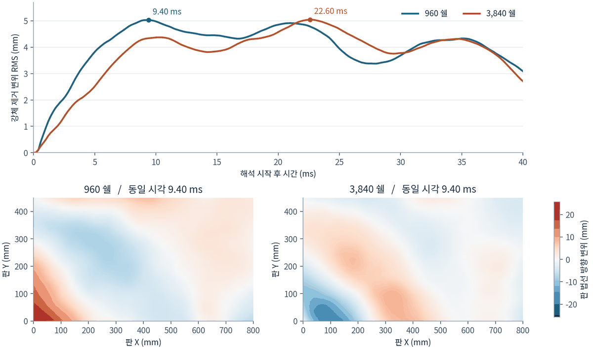
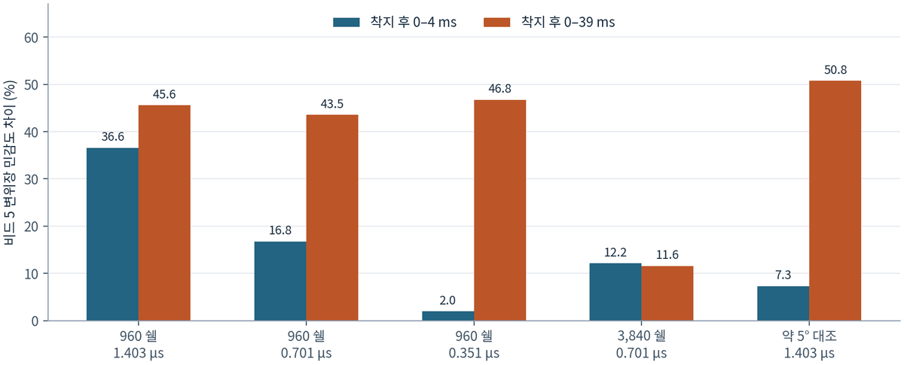
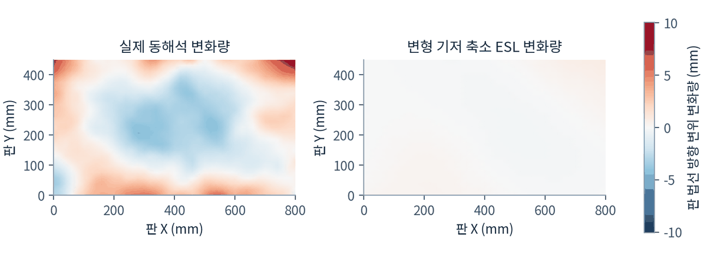

# 탄성 코너 낙하 ESL 후속 검증 · 2026-11-18

**선정 보류.** 수직 코너 조건의 선정 기준을 모두 만족한 ESL이 없었다. 새로운 후보 두 가지와 기준 변위 재사용을 포함해 독립 형상 9건을 비교했다. 후속 계산 69건은 OpenCourant `latest-20261011`의 실제 동해석이며 정상 종료, 출력 시간, 힘과 운동량 잔차, 요소 상태, 질량 검사를 통과했다.

## 메시를 바꾸면 실제 변위장이 바뀐다

수직 코너 기준에서 960쉘과 3,840쉘의 피크 RMS는 5.02889 mm와 5.04524 mm였다. 피크 발생 시점은 해석 시작 9.401 ms에서 22.601 ms로 바뀌었다. 두 메시의 공통 절점과 같은 물리 시각에서 비교한 변위장의 상대 L2 차이는 193.1%다. 9.401 ms에서 두 변위 벡터장의 코사인 유사도는 -0.73이었다.

| 같은 실제 시간증분 약 0.70 μs | 기준 변위장 차이 | 비드 5 깊이 ±0.025 mm 민감도 장 차이 |
|---|---:|---:|
| 수직 코너 90° | 192.1% | 300.0% |
| 60° 코너 확인 계산 | 2.2% | 33.4% |

60°에서도 코너 절점 1번이 먼저 닿는 것을 확인했다. 60°는 판 법선 방향 충돌 속도 성분을 남기기 위해 이번에 정한 시험 자세다. 60°에서의 메시 비교는 기준 및 비드 5 깊이의 정해진 ±0.025 mm 변경에 해당한다. 수직 코너의 독립 형상 벤치마크 및 판정은 동일한 90° 조건에서 유지했다.

## 차분 간격과 시간증분

| 수직 코너 | ±0.05→±0.025 mm, 초기 4 ms | ±0.05→±0.025 mm, 전체 39 ms | ±0.025→±0.0125 mm, 초기 4 ms | ±0.025→±0.0125 mm, 전체 39 ms |
|---|---:|---:|---:|---:|
| 960쉘, 1.403 μs | 12.6% | 57.6% | 36.6% | 45.6% |
| 960쉘, 0.701 μs | 1.6% | 54.8% | 16.8% | 43.5% |
| 960쉘, 0.351 μs | 1.5% | 56.5% | 2.0% | 46.8% |
| 3,840쉘, 0.701 μs | 3.2% | 13.6% | 12.2% | 11.6% |

시간증분은 native 저장 이력의 중앙값이다. 표의 시간 창은 공칭 착지를 기준으로 계산했다. 바닥 접촉 개시는 약 0.161–0.181 ms 구간에 처음 기록된 강체벽 누적 법선 충격량으로 확인했다. 기준 초기 간극 +0.02 mm로 시간 위상을 바꾼 확인 계산에서도 전체 39 ms 차이가 57.7%로 유지됐다. 초기 4 ms의 차분 안정화가 전체 충돌 응답이나 메시 수렴을 보증하지 않는다.

## 방법별 판정

| 방법 | 독립 사례 통과 | 방향 일치 | 최대 전체 변위장 L2 오차 | 최대 변화량 장 L2 오차 | 추가 보정 낙하 |
|---|---:|---:|---:|---:|---:|
| 고정 ESL | 0/9 | 0/9 | 897.3% | 3,401.9% | 0 |
| 증분 형상 ESL + 평형 보정 | 0/9 | 0/9 | 1,963.3% | 7,074.7% | 0 |
| 1차 하중 ESL + 평형 보정 | 1/9 | 1/9 | 230.1% | 829.0% | 12 |
| 변형 기저 축소 ESL | 6/9 | 7/9 | 27.5% | 104.2% | 0 |
| 동해석 응답 1차 근사 · 대조군 | 6/9 | 6/9 | 49.3% | 172.9% | 12 |
| 기준 동해석 변위 재사용 · 대조군 | 6/9 | 0/9 | 28.5% | 100.0% | 0 |

증분 평형 보정은 지점 변경에 따른 상대 L2 차이를 114.3%에서 약 $1.45\times10^{-7}$%로 줄였다. 실제 변위장 예측 오차는 여전히 컸다. 변형 기저 축소 ESL은 기준 1회 동해석에서 32개 모드를 사용했다. 7개 방향을 맞혔으나, 방향 일치 기준 80%는 9건에서 최소 8건이 필요하다. 전체 변위장 L2 기준 15%도 세 사례에서 넘었다. 최적화에 필요한 변위 변화량의 최대 오차는 변위 재사용보다 컸다.

변화량 장 오차는 실제장과 예측장에서 각각 후보 게이지로 투영한 기준 변위를 뺀 뒤 구했다. 참고용 지표이며 기존 통과 기준을 수정하지 않았다. 구성과 전체 결과는 [계약](../../contracts/esl_shape_method_selection.md) 및 [방법 비교 CSV](method_comparison.csv)에 있다.

## 수치 근거와 재현

- [실해석 목록 및 입력·변환 결과 SHA-256](native_run_manifest.csv)
- [수직 코너 방법 비교 설정과 솔버 바이너리 해시](study_provenance.json)
- [차분·시간증분·메시별 민감도](sensitivity_audit.json)와 [자세별 같은 시간증분 비교](inclination_comparison.json)
- [독립 형상별 예측·실측 점수](method_case_scores.csv)
- [F-ESL 두 막대 고정점 검산](first_order_esl_example.json)에서 1차 하중 미분과 직접 동적 미분은 상대 L2 약 $2\times10^{-10}$ 이내로 일치했다. 논문이 표기한 Δt = 0.2에서 목적값은 4.4–7.0% 달랐다. Δt = 0.02에서 두 목적값은 논문 표의 표시 자릿수에 맞았다. 첫 번째 점의 목적함수 미분 중 한 성분 차이는 남았다. [Buzaglo·Pollini §5.1](https://arxiv.org/abs/2508.07222)
- [사용자 PC의 WSL2 재현 명령·Codex 지시문](../../local_codex_shape_methods.md)

실험 자세와 판재는 방법 비교용이다. 사용자 PC의 Windows 실행 및 실제 TV 조립체의 적용 여부는 별도 검증 대상이다.
